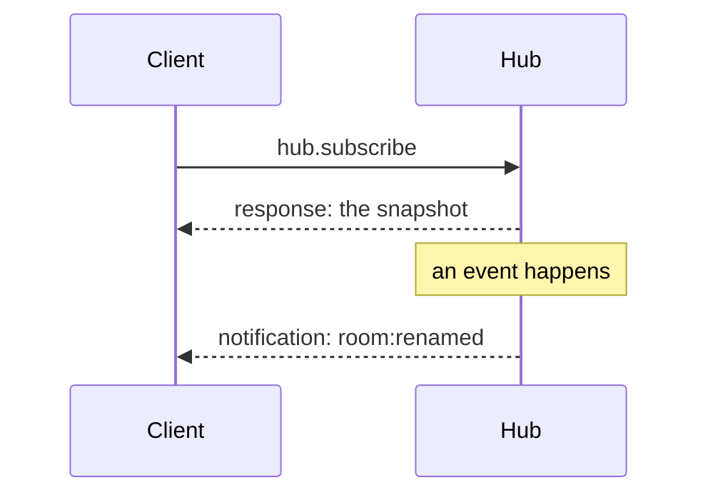
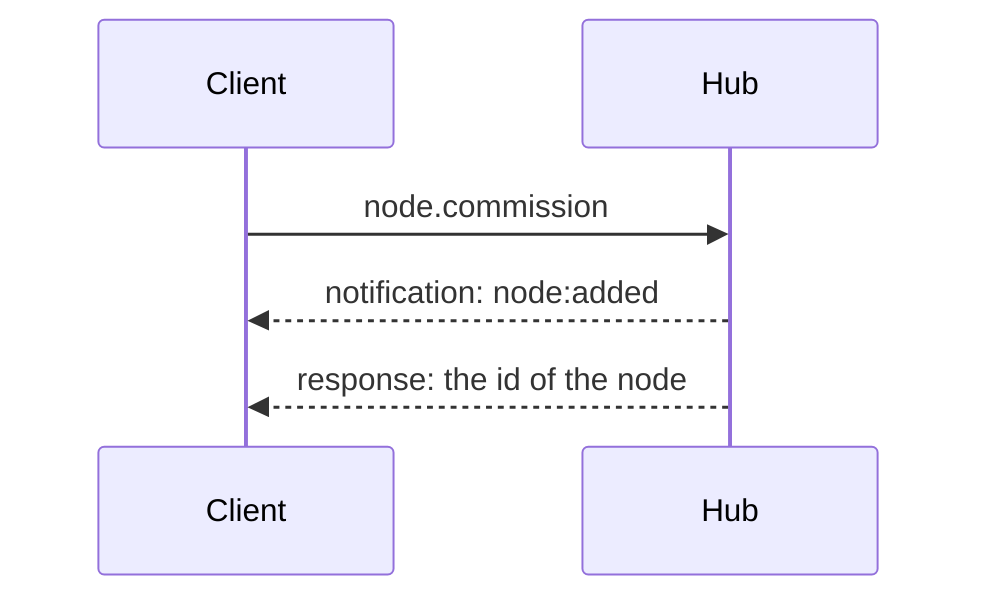

# Protocol

The hub speaks JSON-RPC 2.0 over WebSocket.
This document holds what a client needs beyond the types of the contract: how values are encoded, the rules of the envelope, errors, the handshake, ordering and versioning.
The methods, their parameters and results, and the events are the types of `packages/contract`, and are not repeated here.

## Encoding

Every message is one JSON text in one WebSocket message.

### Integers

Integers are always JSON numbers, in both directions, and are never rounded, written as strings or written in hexadecimal.

An integer has one canonical form: a `number` if it is a safe integer (from -(2^53 - 1) to 2^53 - 1), and a `bigint` otherwise.
The hub reads an integer into its canonical form, and writes a `bigint` that is a safe integer as the same plain number.
A number written with a fraction or an exponent (`1.0`, `1e3`) is a float: it is never a `bigint`.

A client must read the integer literals of a message exactly, and write a `bigint` as its exact literal, because the usual JSON functions round what is outside the safe range.
In JavaScript that is `JSON.parse` with a reviver that reads `context.source`, and `JSON.stringify` with a replacer that returns `JSON.rawJSON`, which is how the hub does it (checked in Node 26.10).

### Bytes

The hub writes an octet string as a string of lowercase hexadecimal digits, two per byte, with no prefix.

### Reserved keys

Keys that start with `$` are reserved.
No method accepts them in its params, and a request that carries one is rejected as invalid params.

The same happens with any other key that a method does not take: the params of a request hold only the parameters of its method.

## Envelope

- A message is a request (it has an `id`) or a notification (it has none), as in JSON-RPC 2.0, with the restrictions below.
- A batch, which is an array, is an invalid request (`-32600`).
- Params go by name, in an object.
  An array in `params` is invalid params (`-32602`), answered under the `id` of the request.
- A notification from the client is discarded, and nothing is answered.
- A response carries the `id` of its request.
  The response to a message that is not valid JSON (`-32700`) or not a valid request (`-32600`) has `id: null`.
- An error never closes the connection.
  Whatever the error is (invalid JSON, an invalid request, an unknown method (`-32601`), invalid params or a handler that fails), the hub answers it and goes on serving the connection.

### Closing

Apart from the handshake, the hub closes a connection in two cases:

- With `1009` (Message Too Big) when a message is larger than 1 MiB.
- With `1001` (Going Away) when the hub stops; a client connects again later.

### Heartbeat

The hub sends a WebSocket ping to every connection every 30 seconds.
A connection that has not answered the previous ping when the next one is due is terminated.
WebSocket clients answer pings by themselves.

## Errors

A failed request is answered with `error: { code, message, data }`.

| JSON-RPC `code` | When                                                                  |
| --------------- | --------------------------------------------------------------------- |
| `-32700`        | The message is not JSON.                                              |
| `-32600`        | The message is not a valid request or notification, or it is a batch. |
| `-32601`        | The method does not exist.                                            |
| `-32602`        | `VALIDATION_ERROR`, which includes params passed by position.         |
| `-32000`        | Any other error of the hub.                                           |

`-32700`, `-32600` and `-32601` are errors of the protocol itself.
Their `data` holds only what helps to correct the message (`issues` for `-32600`, `method` for `-32601`) and never a `code`.

`-32602` and `-32000` are errors of the hub, and their `data` has:

- `code`: the code of the error, which is what a client branches on.
- The data of the error, named after the entity it is about (`roomId`).
- For `VALIDATION_ERROR`, `issues`: a list of `{ path, message }`, with a dotted `path` to the offending field, or `null` if it is the input itself.

`message` is for people, and a client must not branch on it.
For `INTERNAL_ERROR` it is always `"Internal error"`, and the details stay in the log of the hub.
The cause of an error never leaves the hub.

What each `data.code` means for the client:

- `VALIDATION_ERROR` (`-32602`): the input is invalid, so sending the same request again cannot work.
- `NOT_FOUND_ERROR` (`-32000`): the entity that the request names does not exist.
- `CONFLICT_ERROR` (`-32000`): the request contradicts the current state.
- `INTEGRATION_ERROR` (`-32000`): a system outside the hub failed, such as the Matter SDK or SQLite.
- `UNREACHABLE_ERROR` (`-32000`): the target could not be reached, so the request never arrived, and trying again later can work.
- `INTERNAL_ERROR` (`-32000`): an unexpected failure of the hub, which is a bug.
  An error of the hub that is not one of the others is reported as this.

## Handshake

A client connects to the address and the port of the hub with `?v=<schema version>` in the URL, and offers the token as a WebSocket subprotocol.
Browsers cannot set headers on a WebSocket, which leaves the subprotocol as the place for the token.

The hub always accepts the upgrade.
If the handshake is wrong, it closes the connection at once and processes no message of it.
The code of the closing frame says what is wrong, and its reason says it in words:

| Close code | When                                                           |
| ---------- | -------------------------------------------------------------- |
| `4401`     | The token is missing or wrong.                                 |
| `4426`     | The client declares no version, or one the hub does not speak. |

`v` is made of digits only: anything else counts as no version.
If the token and the version are both wrong, the code is `4401`.

If the client offers subprotocols, the hub selects the token if it is among them, and the first of the offered ones if it is not.
That is because a client fails a handshake whose response selects none of the subprotocols it offered, and then never sees the close code (the WebSocket of Node 26.10 reports `1006`).
If the client offers none, the hub selects none and closes with `4401`.

An HTTP request that does not ask for an upgrade is answered with `426` and no body.

## Subscription and order

A connection receives no event until it calls `hub.subscribe`.

The response to `hub.subscribe` is the snapshot, and it is the first message the connection gets after the call: every event that follows happened after the snapshot was taken, and no event is lost between the two.

An event is a notification whose `method` is the name of the event and whose `params` are its payload.
The hub sends every event to every subscribed connection, in the order they happened.

The event of a write is sent before the response to the request that made it, also to the connection that made it, if it subscribed.

A connection that subscribes again gets a new snapshot, and goes on receiving each event once.

### Nodes, endpoints and rooms

`node:added` carries the node with its endpoints, and it is sent before the response to `node.commission`: a client has the node and its endpoints by the time it learns the node's id.

An endpoint has no removal event of its own.
With `node:removed`, the client discards the endpoints of that node.

An endpoint does not get `endpoint:room-changed` when its room is removed.
With `room:removed`, the client sets to `null` the `roomId` of the endpoints that were in that room.

An event can name a node or an endpoint the client does not know, when a commissioning failed after the device joined the fabric; the client ignores it.

`reachable: false` does not mean that the node is gone, only that it does not answer now.
A node stays in `node.list` and in the snapshot, with `reachable: false`, until `node:removed`.

## Versioning

`SCHEMA_VERSION`, in the contract, is the version of this protocol.
A client declares it in `?v=` when it connects, and the hub serves only the version it speaks: any other, and no version at all, closes the connection with `4426`.
